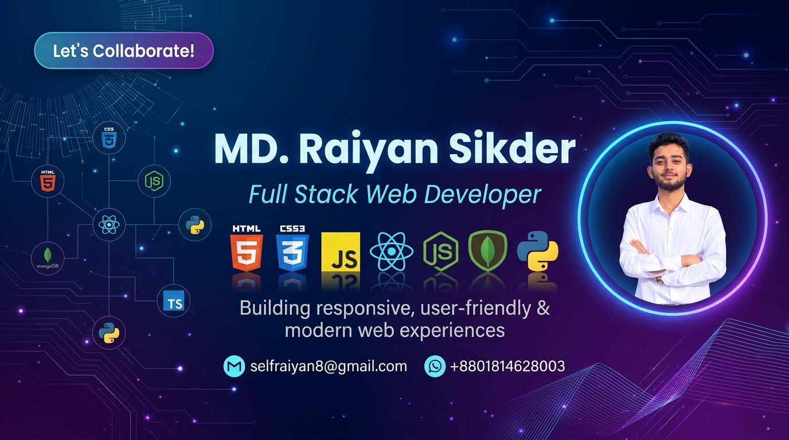

  

<h1 align="center">Hi 👋, I'm MD. Raiyan Sikder</h1>
<h3 align="center">Full Stack Web Developer</h3>

---

### 👨‍💻 About Me
Hi, I'm **MD. Raiyan Sikder**, a passionate Full-Stack Web Developer from Bangladesh. I specialize in building responsive, user-friendly, and scalable web applications using modern technologies like React, Next.js, Node.js, Express, MongoDB, PHP, and Python. I love turning ideas into clean code and delivering high-quality digital solutions.

### 🚀 Current Activities
* 🔭 I’m currently working on **Full-Stack E-Commerce & Institutional Web Applications**
* 🌱 I’m currently exploring **Next.js, TypeScript, and Cybersecurity**
* 🤝 I’m looking to collaborate on **MERN Stack & Open Source Projects**
* 💬 Ask me about **HTML5, CSS3, JavaScript, React, Node.js, MongoDB, Python**
* 📫 How to reach me: **selfraiyan8@gmail.com** | WhatsApp: **+8801814628003**
* ⚡ Fun fact: **I love solving complex bugs and building automation tools!**

---

### 🛠️ Tech Stack & Skills

  

---

### 🌐 Connect with Me

  
  
  
  

---

### 📊 GitHub Stats & Streak

  
  

  

